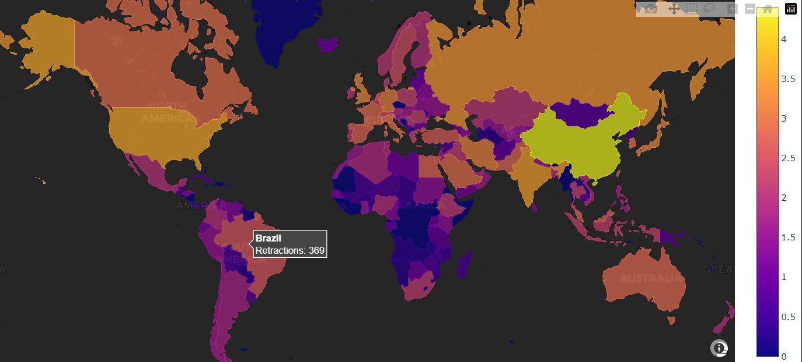
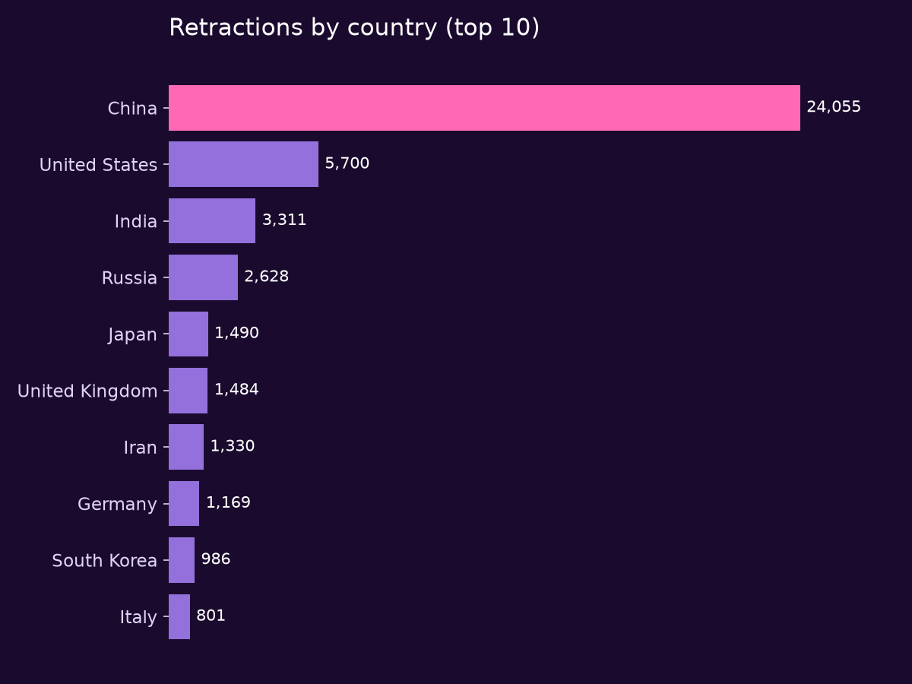
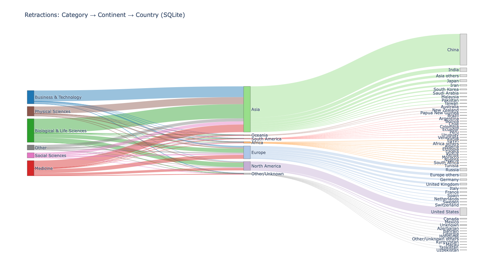

# Retractions of Academic Publications

**Where in the world are research papers retracted, and in which fields?**
An interactive data visualisation of ~48,000 retracted academic papers, built by a
team of three in the PHY1040 data hackathon at Dublin City University.

**[View the website →](https://davidpurcell2-bit.github.io/Hackathon_Group_C/)**



## Key findings

- **China accounts for about half of all retractions**, more than the United States,
  India, Russia and the United Kingdom combined.
- **Medicine and the biological & life sciences** are the largest sources of
  retractions, and most retractions flow through Asia.
- Retractions are concentrated in a few countries, so a linear colour scale showed one
  bright country and a dark world. We used a **log₁₀ colour scale** on the map so
  differences between the other countries stay visible.



## What we built

| Visualisation | What it shows |
| --- | --- |
| **Interactive choropleth map** (Plotly) | Retractions per country on a log scale. Hover or click a country for its data. |
| **[Sankey diagram](https://davidpurcell2-bit.github.io/Hackathon_Group_C/sankey.html)** | How retractions flow from subject area → continent → country |
| **Pie charts** | The mix of subject areas for a selected country |
| **[Website](https://davidpurcell2-bit.github.io/Hackathon_Group_C/)** | Everything in one place |



## How it works

1. **Data:** the Retraction Watch dataset (via Kaggle), stored in **SQLite** and
   queried from Python with pandas.
2. **Cleaning:** papers with several countries are split so each country is counted
   (`str.split(';').explode()`). Country names are then matched to Natural Earth map
   boundaries with **GeoPandas**.
3. **Classifying subjects:** the dataset has hundreds of subject labels. We grouped
   them into broad areas (Medicine, Biological & Life Sciences, Physical Sciences,
   Business & Technology, Social Sciences) using their prefix codes such as `(BLS)`
   and `(PHY)`, with keyword matching as a fallback for labels without a code.
4. **Visualising:** Plotly for the map, Sankey and pie charts, and ipywidgets for the
   interactive dropdown in the notebook.

**Tech:** Python, pandas, NumPy, GeoPandas, Plotly, ipywidgets, SQLite, HTML/CSS/JavaScript

## Run it yourself

```bash
pip install pandas numpy geopandas plotly ipywidgets matplotlib jupyter
cd analysis
```

Unzip `retractions.zip` into the `analysis` folder (it contains `retractions.db`),
then open `Interactive_Choropleth.ipynb` in Jupyter and run all cells.
`PHY1040 Day 4 Group C.ipynb` contains the full analysis, including the Sankey diagram.

## Repository layout

```
analysis/   Jupyter notebooks and the zipped SQLite database
docs/       The project website, the interactive Sankey diagram and images
```

## Team

**David Purcell** (team lead, website), **Darragh Kavanagh** and **Ruth Jordan**

## What I'd do differently

- **Standardise country names before mapping.** The data lists the US both as
  "United States" and "United States of America". Only the second matches the map,
  so about 2,200 US retractions are missing from the choropleth. A name-mapping step
  before the merge would fix this.
- **Normalise by research output**, i.e. retractions per 1,000 papers published, so
  countries that publish more aren't simply ranked higher.
- **Show trends over time**, such as the jump in mass retractions after 2020.

## Follow-up project

I later reused this dataset in [Research Assistant](https://github.com/davidpurcell2-bit/research-assistant),
an AI research assistant that checks the papers it cites against these retractions.

## Data and credits

Retraction data from the [Retraction Watch database](https://retractionwatch.com/).
Country boundaries from [Natural Earth](https://www.naturalearthdata.com/).
Website based on the [Neural Glass](https://templatemo.com/tm-597-neural-glass) template by TemplateMo.
